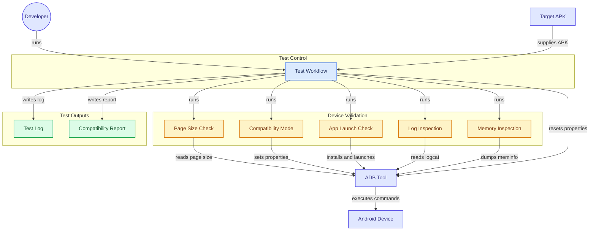

# 16KB Page Size Compatibility Test (Android)

This project provides a **Bash automation script** to test Android apps for compatibility with devices that use a **16 KB memory page size**, as described in Google’s official [Android Page Size Compatibility Guide](https://developer.android.com/guide/practices/page-sizes).  
It installs an APK, checks page-size configuration, enables compatibility mode if required, launches the app, collects logs and memory stats, and generates a report.

> 🧩 This script was developed with help from the official Android documentation and collaboration with colleagues.

---

## 🎯 Purpose

Android 15 introduces support for **16 KB page sizes** on newer ARM devices.  
Apps that rely on native code (C/C++) or memory-intensive workloads may fail to run unless verified.  
This script helps developers **quickly validate** whether their existing APKs can execute safely in such environments.

---

## 🧰 Features

- ✅ Detects the device page size (`getconf PAGE_SIZE`)
- ✅ Enables 16 KB app-compatibility mode on 4 KB systems
- ✅ Installs and launches the specified APK automatically
- ✅ Verifies that the app process is running
- ✅ Checks for logcat warnings or linker issues
- ✅ Dumps memory summary (`dumpsys meminfo`)
- ✅ Generates a concise text report and log file

---

## 🧩 Requirements

- macOS / Linux environment with **bash**
- **ADB** installed and accessible in `$PATH`
- A connected Android 15+ device or 16 KB-capable emulator
- Your target APK file built with compatible NDK or Flutter

---

## ⚙️ Quick Start

```bash
# 1️⃣  Make the script executable
chmod +x test_16kb_compatibility_simple.sh

# 2️⃣  (Optional) Update configuration inside the script
#      APP_PACKAGE="your.app.package"
#      APK_PATH="path/to/your.apk"

# 3️⃣  Run the test
./test_16kb_compatibility_simple.sh
or
sh test_16kb_compatibility_simple.sh
```

The script will:
1. Verify ADB and connected device  
2. Install your APK (uninstalling previous instance if present)  
3. Detect or enable 16 KB compatibility mode  
4. Launch the app and monitor logs  
5. Generate:
   - `16kb_compatibility_test.log`
   - `16kb_compatibility_report.txt`

---

## 📄 Output Example

```
==========================================
16KB Page Size Compatibility Test Report
==========================================
Date: Fri Oct 24 11:21:09 +06 2025
App Package: com.polydrive
Device Page Size: 16384 bytes
App Status: RUNNING
Compatibility Warnings: None found
Memory Usage: Stable (~20 MB)
==========================================
```

---

## 🧠 How It Works

- **Page Size Detection:**  
  Uses `adb shell getconf PAGE_SIZE` to determine device memory page size.

- **Compatibility Mode:**  
  If running on a 4 KB device, the script temporarily enables:
  ```bash
  adb shell setprop bionic.linker.16kb.app_compat.enabled true
  adb shell setprop pm.16kb.app_compat.disabled false
  ```

- **Verification:**  
  Launches the app, inspects running processes, filters logcat output for `"16kb"`, `"page size"`, or `"compat mode"` references, and reports findings.

---

## 🧾 Notes & Best Practices

- Use the **Android 15 system image (16 KB ARM64 emulator)** for best results.  
- Always review logcat for any warnings related to `bionic`, `linker`, or native libraries.  
- Some warnings may originate from system services, not the tested app.  
- The script automatically resets system properties during cleanup.

# Android 16KB Compatibility Test Flow



## 📜 License

This project is licensed under the **MIT License** — see [LICENSE](LICENSE).

---

## 🙌 Acknowledgements

- Based on Google’s [Page Size Compatibility Guide](https://developer.android.com/guide/practices/page-sizes)  
- Contributions and validation from internal QA and engineering colleagues
